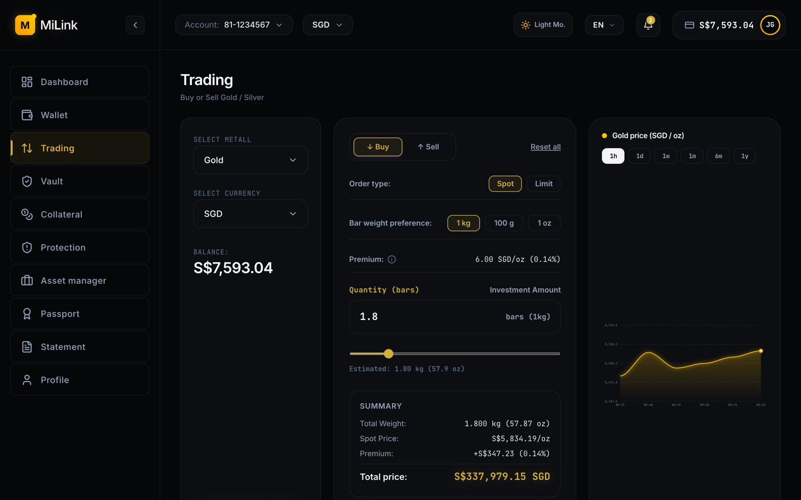

<div align="center">

# 💼 MiLink Wealth Dashboard

A digital-asset and wealth dashboard with trading, wallet, vault, collateral, protection and statement views.

<a href="https://milink-dashboard.vercel.app/"></a>
<a href="https://github.com/miladmo68/Milink-Dashboard"></a>
<a href="https://miladweb.com"></a>

**🔗 Live:** [milink-dashboard.vercel.app](https://milink-dashboard.vercel.app/)

</div>

<p align="center">
  
</p>

## ✨ Features

- Dashboard, trading, wallet, vault and collateral views
- Asset manager, passport, statements and profile pages
- Responsive sidebar layout
- TypeScript, React and Tailwind CSS

## 🛠️ Tech Stack

    

## 🚀 Getting Started

**Prerequisites:** [Node.js](https://nodejs.org/) 18 or newer

**Install and run**

```bash
git clone https://github.com/miladmo68/Milink-Dashboard.git
cd Milink-Dashboard
npm install
npm run dev
```

## 📁 Project Structure

```
Milink-Dashboard/
├── assets/
├── src/
├── index.html
├── metadata.json
├── package.json
├── tsconfig.json
└── vite.config.ts
```

## 👤 Author

**Milad Mohammadi** — Frontend-Focused Full-Stack Developer, Toronto 🇨🇦

[](https://miladweb.com)
[](https://www.linkedin.com/in/miladmo68/)
[](https://github.com/miladmo68)

<p align="center"><sub>If you like this project, consider giving it a ⭐</sub></p>
